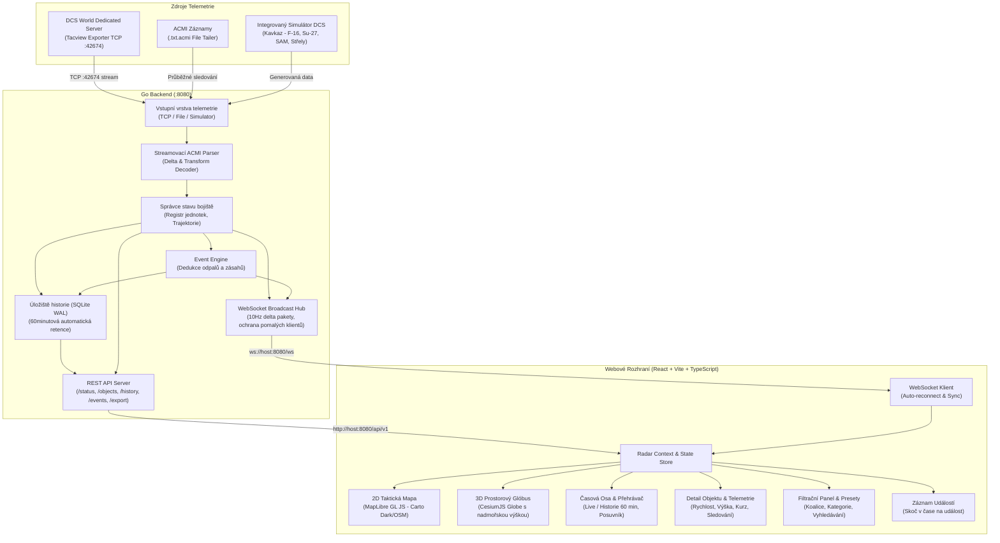

# DCS Radar

Moderní realtime webová aplikace pro příjem, analýzu a prostorovou vizualizaci telemetrických dat z Tacview exporteru běžícího na serveru **DCS World Dedicated Server**.

Systém poskytuje operativní taktický přehled v reálném čase (2D taktická mapa i 3D prostorový glóbus), udržuje kompletní 60minutovou historii operace s možností plynulého přehrávání (scrubbing, zrychlení 0.25× až 4×) a nabízí dedukci bojových událostí (odpaly střel, pravděpodobné zásahy, zničení techniky).

---

## 1. Architektura a tok dat



---

## 2. Přehled adresářové struktury projektu

```text
dcs-radar/
├── config.yaml               # Výchozí konfigurace aplikace
├── config.example.yaml       # Detailně komentovaný vzor konfigurace
├── docker-compose.yml        # Produkční deployment pro Ubuntu Server
├── Dockerfile                # Vícefázový build (Node frontend + Go backend + Alpine)
├── .dockerignore
├── .gitignore
├── README.md                 # Kompletní provozní a technická dokumentace
├── server/                   # Backend v jazyce Go
│   ├── main.go               # Vstupní bod, CLI příznaky, graceful shutdown
│   ├── config/               # Načítání a validace YAML konfigurace
│   ├── models/               # Normalizovaný datový model (Object, Transform, Event, Status)
│   ├── acmi/                 # Streamovací parser ACMI protokolu a výpočty souřadnic
│   │   ├── parser.go         # Parsování řádků, transformací T=, mazání -id
│   │   ├── parser_test.go    # Testy parseru a syntaxe ACMI
│   │   ├── transform.go      # Haversine, azimut, rychlost, MSL výška
│   │   └── transform_test.go
│   ├── telemetry/            # Vstupní adaptéry telemetrie
│   │   ├── source.go         # Interface zdroje telemetrie
│   │   ├── tcp_source.go     # TCP klient s Tacview RTT handshakem
│   │   ├── file_source.go    # Průběžné sledování aktivního .txt.acmi souboru
│   │   ├── simulator.go      # Realistický simulátor vzdušného boje nad Kavkazem
│   │   └── source_test.go
│   ├── state/                # Správce živého stavu a odvozování událostí
│   │   ├── manager.go        # Thread-safe registr objektů a trajektorií
│   │   ├── events.go         # Dedukce odpalů zbraní, despawnů a zničení techniky
│   │   └── manager_test.go
│   ├── history/              # 60minutová historie a retence
│   │   ├── store.go          # SQLite v režimu WAL, časové snapshoty
│   │   ├── retention.go      # Automatický čistič dat starších než 60 minut
│   │   └── store_test.go
│   ├── api/                  # REST API a WebSocket
│   │   ├── server.go         # HTTP router, middleware (CORS, proxy), servírování SPA
│   │   ├── rest.go           # REST endpointy (/status, /objects, /history, /export)
│   │   ├── websocket.go      # WebSocket hub s ochranou pomalých klientů
│   │   └── handlers_test.go
│   └── testdata/             # Testovací ACMI záznam
│       └── sample.acmi
└── web/                      # Frontend v React + TypeScript + Vite
    ├── package.json
    ├── vite.config.ts        # Konfigurace Vite a integrace CesiumJS
    ├── src/
    │   ├── App.tsx           # Hlavní komponenta rozhraní
    │   ├── main.tsx          # Vstupní bod aplikace
    │   ├── context/          # Globální stav radaru a časové osy
    │   ├── services/         # REST klient a WebSocket s auto-reconnectem
    │   ├── types/            # TypeScript rozhraní odpovídající Go modelům
    │   ├── components/
    │   │   ├── Header/       # Horní systémový panel (stav, koalice, přepínač 2D/3D)
    │   │   ├── Map/          # 2D taktická mapa (MapLibre GL JS)
    │   │   ├── Globe3D/      # 3D prostorový glóbus (CesiumJS)
    │   │   ├── Timeline/     # 60minutová časová osa, přehrávač, scrubbing
    │   │   ├── Sidebar/      # Detail jednotky, letové parametry, export
    │   │   ├── FilterPanel/  # Filtry koalic, kategorií, hledání, presety
    │   │   ├── Events/       # Chronologický panel událostí s časovými skoky
    │   │   └── Diagnostics/  # Diagnostické okno systému
    │   └── styles/           # Taktický tmavý design a radarový vizuální styl
```

---

## 3. Požadavky na server

- **Operační systém**: Ubuntu Server 22.04 LTS nebo 24.04 LTS (podporován libovolný moderní Linux x86_64 / arm64).
- **Procesor (CPU)**: 2 jádra (doporučeno pro zpracování telemetrie a obsluhu WebSocket klientů).
- **Operační paměť (RAM)**: Min. 2 GB (doporučeno 4 GB pro rozsáhlé mise s desítkami současně sledovaných objektů a 3D zobrazení).
- **Úložiště**: Min. 10 GB volného místa na disku pro SQLite historii telemetrie (60minutová retence automaticky uvolňuje místo).
- **Software**: Docker Engine a Docker Compose v2.

---

## 4. Instalace a spuštění pomocí Docker Compose

### Krok 1: Klonování repozitáře a přechod do adresáře
```bash
git clone <url-repozitare> dcs-radar
cd dcs-radar
```

### Krok 2: Příprava konfigurace
```bash
cp config.example.yaml config.yaml
# Upravte parametry podle vašeho prostředí:
nano config.yaml
```

### Krok 3: Sestavení a spuštění kontejneru
```bash
docker compose up -d --build
```

### Krok 4: Kontrola stavu a logů
```bash
docker compose ps
docker compose logs -f dcs-radar
```

Aplikace je nyní dostupná v prohlížeči na adrese: `http://<IP-vaseho-serveru>:8080/`

---

## 5. Propojení s DCS World Dedicated Server a Tacview Exporterem

Tacview exporter na DCS serveru lze integrovat dvěma způsoby:

### Varianta A: Přímé síťové TCP spojení (Doporučeno pro minimální latenci)

1. Na **Windows DCS Dedicated Serveru** ověřte, že je nainstalován a aktivní Tacview exporter v adresáři:
   `%USERPROFILE%\Saved Games\DCS.openbeta_server\Scripts\Hooks\TacviewGameGUI.lua` (nebo odpovídající DCS server profil).
2. V konfiguraci Tacview na DCS serveru (`Tacview` -> `Options` -> `Real-Time Telemetry`):
   - Povolte **Real-Time Telemetry Host**.
   - Nastavte port (výchozí: `42674`).
   - Nastavte případné heslo (nebo nechte prázdné).
   - Ve Windows Firewall povolte příchozí TCP port `42674`.
3. V souboru `config.yaml` na Ubuntu serveru nastavte:
   ```yaml
   telemetry:
     type: "tcp"
     tcp:
       host: "192.168.1.50" # IP adresa DCS serveru
       port: 42674
       password: ""
       client_name: "DCS-Radar"
       reconnect_interval_sec: 5
       timeout_sec: 10
   ```
4. Restartujte kontejner:
   ```bash
   docker compose restart dcs-radar
   ```

### Varianta B: Průběžné sledování zapisovaného souboru ACMI (.txt.acmi)

Pokud bezpečnostní pravidla nedovolují otevřít TCP port mezi DCS a Ubuntu serverem, můžete sdílet adresář se záznamy DCS přes SMB/NFS nebo průběžně synchronizovat soubory (např. přes rsync/sshfs).

1. Na Ubuntu serveru připojte sdílenou složku ze serveru DCS do lokálního adresáře, např. `/mnt/dcs_tacview`.
2. V `docker-compose.yml` namapujte tento adresář:
   ```yaml
   volumes:
     - /mnt/dcs_tacview:/data/tacview:ro
   ```
3. V `config.yaml` nastavte:
   ```yaml
   telemetry:
     type: "file"
     file:
       directory: "/data/tacview"
       auto_detect_latest: true
       poll_interval_ms: 250
   ```
4. Backend automaticky detekuje nový vzniklý `.txt.acmi` soubor při startu mise, průběžně čte přibývající řádky na konci souboru a zvládá rotaci souborů při změně mapy.

### Varianta C: Interní realistický simulátor

Pokud nemáte DCS server právě zapnutý nebo chcete systém otestovat, nastavte v `config.yaml`:
```yaml
telemetry:
  type: "simulator"
  simulator:
    update_rate_hz: 5.0
    scenario: "caucasus_dogfight"
```
Simulátor generuje autentický letecký souboj nad Kavkazem (letouny F-16C, Su-27, MiG-29, vrtulník Mi-24, radar PVO SA-10, námořní křižník a naváděné střely vzduch-vzduch AIM-120C s vizualizací zničení).

---

## 6. Ovládání aplikace

### Živé sledování (Hlavní režim)
- **2D Taktická mapa**: Zobrazuje aktuální polohy techniky, barevné odlišení koalic (Modrá = spojenci, Červená = nepřátelé, Zelená = neutrální), směrové vektory a stopy trajektorií.
- **3D Glóbus**: Přepnutím tlačítka v horní liště se scéna přenese do 3D prostoru (CesiumJS). Objekty se vykreslují v reálné nadmořské výšce nad zemským povrchem s prostorovými trajektoriemi.
- **Výběr objektu**: Kliknutím na značku na mapě nebo v tabulce se otevře pravý postranní panel s detailní telemetrií (výška MSL, rychlost IAS/GS, kurz, náklon a sklon letounu, jméno pilota, volací znak).
- **Sledování kamerou**: Tlačítkem „Sledovat kamerou“ se mapa či 3D glóbus automaticky centruje na pohybující se letoun.

### 60minutová historie a přehrávání
- **Spodní časová osa**: Přehledný posuvník reprezentuje posledních 60 minut.
- **Přechod do minulosti**: Kliknutím na časovou osu nebo tlačítkem „Zastavit čas“ se mapa přepne do historického režimu (oranžový indikátor s časovým posunem, např. `-15m 30s`).
- **Rekonstrukce stavu**: V historickém čase mapa zobrazuje přesný zrekonstruovaný stav bojiště v daném okamžiku.
- **Příjem dat na pozadí**: I při procházení minulosti backend stále na pozadí přijímá nová živá data z DCS.
- **Návrat k živému přenosu**: Jediným kliknutím na zelené tlačítko „Přejít na živě“ se okamžitě vrátíte do aktuálního času bez nutnosti obnovovat stránku.
- **Rychlosti přehrávání**: 0.25×, 0.5×, 1×, 2×, 4×.

### Filtrování
- **Panel filtrů**: Otevírá se tlačítkem v horní liště. Umožňuje filtrovat koalice, kategorie (letadla, vrtulníky, pozemní technika, lodě, střely), výškové a rychlostní rozmezí a textové vyhledávání.
- **Předvolby (Presety)**: Rychlá tlačítka „Vše“, „Pouze letadla“, „Modrá koalice“, „Červená koalice“, „Zbraně“. Možnost uložit si vlastní nastavení do prohlížeče (`localStorage`).

---

## 7. Popis API a WebSocket

### REST API endpointy
- `GET /api/v1/health`: Healthcheck pro Docker a reverzní proxy.
- `GET /api/v1/ready`: Ověření připravenosti subsystémů.
- `GET /api/v1/status`: Stav připojení k exporteru, latence, počet objektů, koaliční počty a rozsah historie.
- `GET /api/v1/objects`: Seznam všech aktuálně aktivních objektů na bojišti.
- `GET /api/v1/objects/{id}`: Detail konkrétního objektu včetně trajektorie letu.
- `GET /api/v1/history/range`: Minimální a maximální dostupný čas v databázi historie.
- `GET /api/v1/history/snapshot?time=2026-10-22T12:00:00Z`: Rekonstrukce kompletního stavu bojiště v zadaném čase.
- `GET /api/v1/events?limit=50`: Seznam chronologických událostí mise.
- `GET /api/v1/history/export?format=csv&objectId=1001`: Export trajektorie do CSV nebo GeoJSON.
- `GET /api/v1/config`: Veřejná klientská konfigurace mapových podkladů.

### WebSocket kanál (`/ws`)
- Při navázání spojení klient obdrží zprávu typu `snapshot` obsahující kompletní počáteční stav všech jednotek a událostí.
- Následně server v dávkách (10 Hz) odesílá zprávy typu `delta` obsahující změněné souřadnice, vzniklé nebo smazané jednotky.
- Ochrana pomalých klientů: Buffer o velikosti 256 zpráv; při zahlcení pomalého mobilního klienta se starší zprávy zahodí, aniž by došlo k blokování telemetrického jádra.

---

## 8. Správa úložiště a retence

- Backend využívá optimalizovanou vestavěnou databázi SQLite v režimu WAL (Write-Ahead Logging) bez nutnosti externí databáze.
- V pozadí běží retenční proces (`RetentionWorker`), který každých 60 sekund odstraňuje data starší než hodnota `retention_minutes` (výchozích 60 minut).
- Spotřeba disku při 50 současně aktivních objektech v DCS nepřekračuje přibližně 15–30 MB za hodinu.

---

## 9. Nasazení za reverzní proxy (Traefik / Nginx)

Pro produkční nasazení s TLS certifikátem (HTTPS / WSS) doporučujeme reverzní proxy.

### Příklad konfigurace Nginx:
```nginx
server {
    listen 443 ssl http2;
    server_name radar.vase-domena.cz;

    ssl_certificate /etc/letsencrypt/live/radar.vase-domena.cz/fullchain.pem;
    ssl_certificate_key /etc/letsencrypt/live/radar.vase-domena.cz/privkey.pem;

    location / {
        proxy_pass http://127.0.0.1:8080;
        proxy_http_version 1.1;
        proxy_set_header Upgrade $http_upgrade;
        proxy_set_header Connection "upgrade";
        proxy_set_header Host $host;
        proxy_set_header X-Real-IP $remote_addr;
        proxy_set_header X-Forwarded-For $proxy_add_x_forwarded_for;
        proxy_set_header X-Forwarded-Proto $scheme;
        proxy_read_timeout 3600s;
        proxy_send_timeout 3600s;
    }
}
```

---

## 10. Diagnostické příkazy a řešení potíží

| Úkol | Příkaz |
|---|---|
| Kontrola stavu kontejneru | `docker compose ps` |
| Sledování provozních logů | `docker compose logs -f dcs-radar` |
| Ověření REST API z příkazové řádky | `curl -s http://localhost:8080/api/v1/status \| jq .` |
| Ověření aktivních jednotek | `curl -s http://localhost:8080/api/v1/objects \| jq .count` |
| Kontrola velikosti databáze | `ls -lh data/history.db*` |
| Restart aplikace | `docker compose restart dcs-radar` |
| Sestavení lokálního binárního souboru | `cd server && go build -o ../dcs-radar main.go` |
| Spuštění automatizovaných testů | `cd server && go test ./... -v` |
